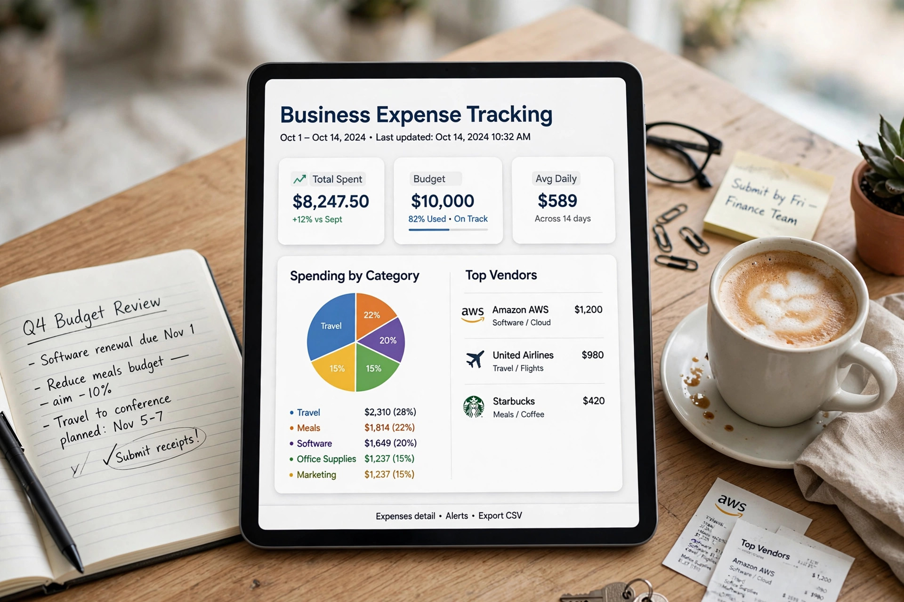
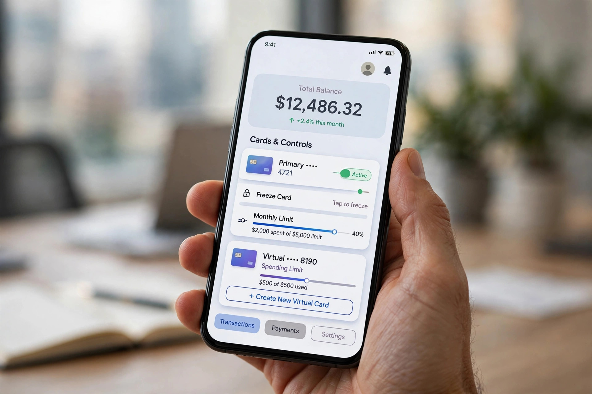
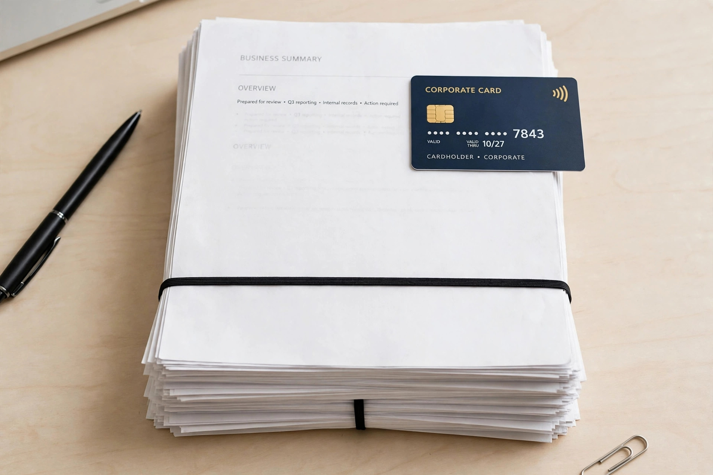
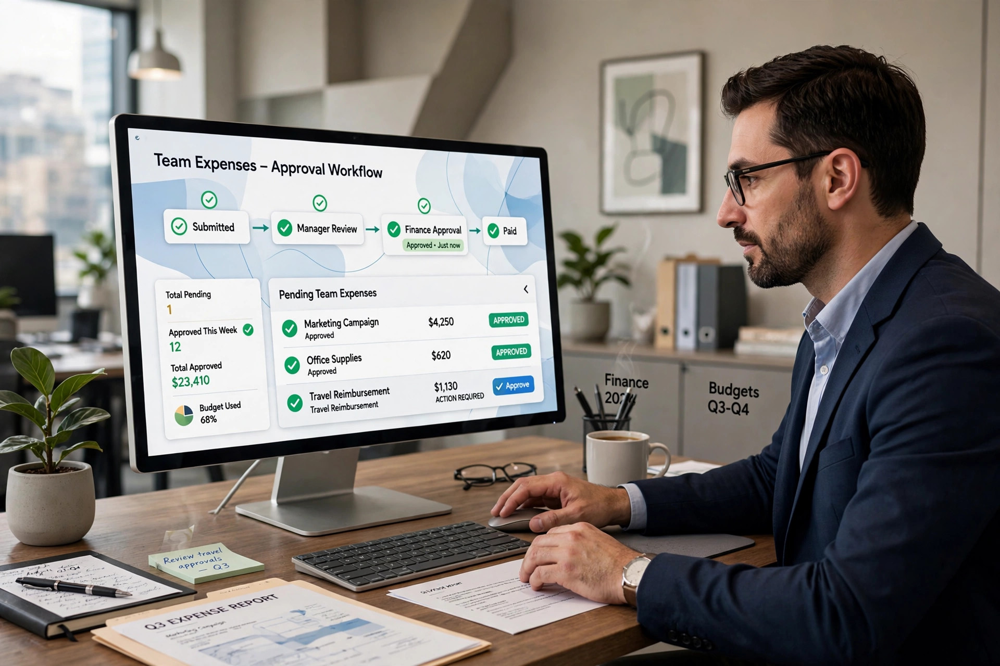

# Brex Business Credit Card: The Complete Step-by-Step Guide to the Brex Corporate Card (2026)

If your company is growing and your team keeps asking for a better way to pay for software, travel, ads and everyday expenses, you have probably already come across **Brex**. What started in 2017 as a card built for startups has grown into a complete spend-management platform used by tens of thousands of companies. But Brex works very differently from the business credit cards most founders grew up with, and that difference causes a lot of confusion.

This guide walks you through everything, step by step: what Brex actually is, who qualifies, exactly how to apply and set up your account, how the [brex login](https://brexcardadvisor.com/brex-login) and dashboard work, how cards and limits are calculated, what the rewards and fees look like, and how Brex compares with the alternatives. By the end, you will know whether a [brex business credit card](https://brexcardadvisor.com/brex-business-credit-card) belongs in your company's finance stack — and if it does, you will know precisely how to get one.

One note before we begin: Brex Card Advisor is an independent guide to the Brex platform. It is not affiliated with Brex Inc. or Capital One, and this article is written to help you evaluate the product on its merits.

## What Is Brex? A Quick Company Background

[Brex](https://brexcardadvisor.com) is a financial technology company founded in 2017 in San Francisco by Pedro Franceschi and Henrique Dubugras, who had previously built the Brazilian payments company Pagar.me. The [brex company](https://brexcardadvisor.com) story is really a story about a gap in the market: traditional banks underwrite business cards using the founder's personal credit history, which meant well-funded startups with millions in the bank were often offered tiny limits — or rejected outright — simply because the company was young.

Brex flipped that model. Instead of judging the founder, Brex judges the business: its cash balance, revenue, funding and spending patterns. That approach made the [brex corporate card](https://brexcardadvisor.com/brex-corporate-card) famous in the startup world, and the platform has since expanded far beyond cards into expense management, business accounts, bill pay, travel booking and reimbursements.

In January 2026, Capital One announced its agreement to acquire Brex, and the acquisition was completed on April 7, 2026. Brex continues to operate under its own brand, with Franceschi still leading the business, but it is now part of Capital One. If you are reading older reviews written before April 2026, keep that ownership change in mind.

People find Brex through many searches. Some type [brex com](https://brexcardadvisor.com) looking for the official site, others type the single word [brexcard](https://brexcardadvisor.com), and some even search "brexbank" because they assume Brex is a bank. It is not: Brex is a fintech company, not a bank, and that distinction matters when we discuss the business account later in this guide.

## Is the Brex Card a Credit Card or a Charge Card?

This is the single most common misunderstanding, so let us clear it up early. People search for the [brex credit card](https://brexcardadvisor.com/brex-business-credit-card), the [brex business card](https://brexcardadvisor.com/brex-business-credit-card) and the [brex corporate credit card](https://brexcardadvisor.com/brex-corporate-card) as if they were three different products. In reality, they are all describing the same thing: the Brex Card, which is technically a **business charge card**.

The difference matters. A traditional revolving credit card lets you carry a balance from month to month and pay interest on it. A charge card does not revolve: the balance is repaid in full on a set schedule — with Brex, either daily or monthly depending on how your account qualifies. There is no traditional purchase APR to compare, because you are not meant to borrow over time.

For many companies this is a feature, not a limitation. There is no personal guarantee, Brex states that applying does not affect your personal credit score, and limits are based on your company's finances rather than a founder's FICO score. If, on the other hand, your business genuinely needs to carry balances for several months, a conventional [brex business credit cards](https://brexcardadvisor.com/brex-business-credit-card) alternative — a true revolving card — may suit you better. We compare those options later in this guide.

## Who Is Brex Best For?

Brex is designed for incorporated businesses, and it shines brightest for:

- **Funded startups** that have raised capital and need real limits immediately.
- **Growing companies** issuing cards to many employees across teams and countries.
- **Finance teams** that want budgets, approvals and receipt rules enforced *before* money is spent, not after.
- **Mid-market and enterprise companies** that want cards, expenses, bill pay and travel in one system.

It is a weaker fit for sole proprietors (who are not currently eligible), very small businesses that only need one simple card, and companies that need revolving credit. The [brex corporate card for startups](https://brexcardadvisor.com/brex-for-startups) is the classic use case, but bootstrapped and revenue-generating companies can qualify too, as the eligibility section explains.

## Eligibility: Brex Card Requirements Explained

Brex does not approve everyone, and understanding the requirements before you apply saves time. The full breakdown is on our [requirements page](https://brexcardadvisor.com/brex-card-requirements), but the essentials are:

**Business identity requirements**
- A U.S. Employer Identification Number (EIN) issued by the IRS
- Valid U.S. incorporation (C-corp, LLC and other incorporated entities)
- U.S. operations and a physical U.S. address — a P.O. box or private mailbox does not count
- Sole proprietors and unincorporated partnerships are not eligible

**Financial requirements (they vary by repayment type)**
- *Daily payments:* companies may qualify based on factors such as equity investment, or annual revenue above Brex's published thresholds (currently above $500,000 in annual revenue for one common path).
- *Monthly payments:* funded startups generally need a minimum cash balance — Brex currently publishes $50,000 for venture-funded startups, with some exceptions — while commercial and larger companies are assessed on revenue and financial statements.

Meeting a published threshold never guarantees approval. Brex also reviews your business model, source of funds, financial health and expected spending patterns. What it does *not* do is underwrite the card using your personal credit, and no founder has to sign a personal guarantee.

## Step-by-Step: How to Apply for Brex and Set Up Your Account

Here is the complete process, from first click to a working card in an employee's hands.

### Step 1: Check your eligibility honestly

Before anything else, run through the requirements above. Confirm your company is incorporated in the U.S., has an EIN, a physical U.S. address, and meets the cash or revenue profile for the repayment type you want. If you are a sole proprietor, stop here and look at the alternatives section instead — Brex will not approve the application.

### Step 2: Gather your documents in advance

Applications go faster when everything is in one folder. Prepare:

- Your EIN and incorporation details (legal company name, state of incorporation)
- A physical U.S. business address (plus a utility bill, lease or bank statement if Brex needs to verify it)
- Details of beneficial owners and controlling officers (name, date of birth, identification) for compliance verification
- Recent bank statements or a connection to your business bank account
- Funding information if you are a startup (amount raised, investors), or recent financial statements if you are revenue-based

### Step 3: Start the application on the Brex website

Go to the Brex website and begin the signup flow. You will create your admin account with your work email and a secure password. This is the same account you will later use for the [brex login](https://brexcardadvisor.com/brex-login) page every day, so use an email you control long-term, not a temporary one.

### Step 4: Enter your company information

Provide the legal business name, EIN, incorporation type and state, industry, business address and a short description of what your company does. Be accurate and consistent: the details should match your incorporation records and bank information exactly, because mismatches are a common cause of verification delays.

### Step 5: Complete identity and compliance verification

Brex will verify the business and the people behind it. Beneficial owners and the controlling officer typically provide identification details. This is a regulatory Know-Your-Customer check — it is not a personal credit check, and Brex states it does not affect personal credit scores.

### Step 6: Connect your bank or submit financials

To set your limit, Brex needs visibility into company finances. Most applicants connect their primary business bank account securely during onboarding; larger or monthly-payment applicants may upload financial statements such as income statements, balance sheets and cash-flow statements instead. If you plan to use daily payments, funding a Brex business account is part of this stage, because daily-payment limits are primarily tied to the funds held there.

### Step 7: Choose your repayment schedule

Depending on qualification, your card account will be set to daily or monthly payments. With daily payments, cleared transactions are collected from your account each day, which keeps the balance near zero and can suit companies that keep funds in Brex. With monthly payments, the statement balance is due in full each cycle. Either way, remember: this is a charge card, so the full amount must be paid — there is no minimum-payment option.

### Step 8: Wait for the underwriting decision

Brex reviews the application against its underwriting criteria. Straightforward applications from clearly qualifying companies are typically decided quickly; applications that need extra documentation take longer. If Brex asks for more information, respond with exactly what was requested — partial answers are the most common self-inflicted delay.

### Step 9: Configure your account before issuing cards

Once approved, resist the urge to hand out cards immediately. First, set up the structure that makes Brex valuable:

1. **Create spend limits and budgets** for teams, departments or purposes (for example: software, travel, marketing).
2. **Set approval policies** — who must approve what, and at which amounts.
3. **Set receipt and memo rules** so documentation is collected automatically at the point of purchase.
4. **Invite your finance team** and assign admin, bookkeeper and employee roles.
5. **Connect your accounting software** so transactions sync with the right chart of accounts.

### Step 10: Issue cards and activate them

Now issue physical cards for employees who spend in person, and virtual cards for online purchases, subscriptions and vendors. Each card is attached to a spend limit, so an employee never has access to the company's entire line. Cardholders activate their cards, add virtual cards to mobile wallets where supported, and your [brex card](https://brexcardadvisor.com/brex-card) program is live.

## Brex Login and the Dashboard: Your Daily Control Center

Day-to-day, everything happens after you sign in. The [brex login](https://brexcardadvisor.com/brex-login) page is where admins and employees start their session — our dedicated guide covers the login process, two-factor authentication, single sign-on options, mobile app access and the fixes for the most common sign-in problems.

Once inside, the dashboard is organized around control rather than after-the-fact reporting:

- **Cards:** view every physical, virtual and purchasing card, its limit, and its recent activity; freeze or replace a card in a few clicks.
- **Expenses:** see transactions flowing in real time, with receipts and memos attached, and exceptions flagged for review.
- **Budgets and spend limits:** track how much of each budget is used, and adjust limits as plans change.
- **Payments and bills:** review scheduled payments, invoices in Bill Pay, and upcoming card repayments.
- **Reports:** export or sync coded transactions to your accounting system.

Employees see a simpler view: their own cards, their remaining limit, and an easy way to photograph a receipt or add a memo. That separation is deliberate — the people spending money should find compliance effortless, and the people overseeing it should find everything in one place.

## Brex Cards and Credit Limits: How They Work

Brex offers three broad card types, all managed in the same system:

- **Employee cards** — physical or virtual cards for everyday staff spending like travel, meals and supplies, each with its own cardholder limit.
- **Purchasing cards (P-cards)** — cards for operational and vendor spending such as SaaS subscriptions, cloud services and ad platforms. Putting a vendor on a dedicated purchasing card means a subscription survives staff changes and a compromised card can be replaced without touching anyone else's credentials.
- **Virtual cards** — number-only cards created instantly for a specific purpose, subscription or spend limit, ideal for isolating recurring charges.

Your overall company limit is the ceiling for total card spending, while each card and spend limit controls how much of that ceiling any person or purpose can use. A company might have a large overall limit, yet give a salesperson a modest monthly employee-card limit plus a separate, temporary travel limit for a conference.

How is the company limit calculated? Brex's documentation points to business-level factors: connected bank balances, funds in the Brex business account, revenue, capital raised, and financial statements. Limits can change as your financial profile changes — growing companies often see capacity grow with them, while a shrinking cash position can reduce it. Our guide to the [brex card limit](https://brexcardadvisor.com/brex-card-limit) explains the calculation in more detail, including the difference between daily-payment limits (tied closely to account funds) and monthly-payment limits (based more on overall financials).

## Brex Rewards and the Real Meaning of "Brex Value"

Rewards are where a lot of buyers start their comparison, and Brex does run a points program: card spending earns a base reward, with category multipliers available under its rewards programs for common business categories such as rideshare, travel, restaurants and software. Points can typically be redeemed in ways that suit businesses — for example toward travel, statement value or transfers to partner programs, depending on your plan and current program terms.

But focusing only on points misses the bigger calculation. When experienced finance teams talk about [brex value](https://brexcardadvisor.com/brex-card-rewards), they usually mean the total package: the hours saved on receipt-chasing and month-end coding, the out-of-policy spending prevented by limits set in advance, the fraud and duplicate subscriptions caught early because every vendor sits on a visible, dedicated card, and the value of a limit that reflects your actual cash position instead of a founder's personal credit file. Points are a bonus on top of that operational value, not a substitute for it. Our [brex card rewards](https://brexcardadvisor.com/brex-card-rewards) guide breaks down earning, redemption options and how to judge whether the rewards fit your spending mix.

## Brex Fees: What Does It Actually Cost?

The card itself is refreshingly simple: the underlying card carries a **$0 annual fee**. The money question is really about software. Brex offers a free entry plan (Essentials, at $0 per user per month) and a Premium tier (published at $12 per user per month) that unlocks more advanced controls and features. Which tier you need depends on how complex your approval chains, policies and global footprint are.

Other cost points to check before you commit:

- **Foreign transactions:** international use is supported, but when a currency conversion is required, Brex applies an FX markup (up to 3% per its published details), so heavy foreign-currency spenders should factor this in.
- **No interest — because there is no revolving:** you cannot carry a balance, so there is no purchase APR; equally, there is no option to spread a large purchase over months.
- **Late payment risk:** paying in full is mandatory, so treat the repayment schedule as a hard operational deadline, not a guideline.

For the complete, current picture, see our page on [brex card fees](https://brexcardadvisor.com/brex-card-fees), and always confirm pricing on the official site before signing up, because plans evolve.

## Expense Management: Where Brex Pulls Away from Ordinary Cards

A traditional card gives you a statement at the end of the month and leaves the detective work to you. Brex tries to eliminate the detective work entirely:

- **Policies before purchases.** Spend limits define what can be bought, by whom, and up to what amount — so many policy violations simply cannot happen.
- **Automatic documentation.** Receipts are collected and matched to transactions, memos are prompted at the time of purchase, and AI-assisted categorization assigns expenses to the right accounts.
- **Approvals and exceptions.** Anything outside policy is routed for review instead of being discovered weeks later.
- **Reimbursements in the same system.** Out-of-pocket employee expenses can be submitted, approved and repaid alongside card spend.
- **Accounting sync.** Coded transactions flow into supported accounting platforms, shortening the month-end close.
- **Bill Pay and travel built in.** Invoices can be uploaded or forwarded, data extracted, approvals chained and payments scheduled by ACH, check, wire or card; travel can be booked and tied to travel budgets in the same platform.

This is why Brex is best understood as finance software with a card attached, rather than a card with an app attached. Brex also reports payment performance to business credit bureaus, so responsible use can contribute to building your company's business credit profile over time.

## The Brex Business Account and the "Brex Bank" Question

Because users often search for [brex bank](https://brexcardadvisor.com/brex-business-account) or even the merged term brexbank, it is worth stating plainly: **Brex is not a bank.** It is a financial technology company, and its business-account services are provided through partner arrangements rather than Brex holding a banking charter itself.

The [brex business](https://brexcardadvisor.com/brex-business-account) account offering is designed to sit at the center of the platform. Companies can hold funds, make payments, and use the account alongside their cards. The integration matters most for daily-payment cardholders: because daily-payment limits are primarily tied to the funds held in the Brex business account, the account balance effectively drives how much the team can spend. For monthly-payment customers, the account is more of a convenience and visibility layer on top of revenue-based underwriting.

In practical terms, think of Brex as the operating system for company money — cards, account, expenses, bills and travel in one login — rather than as a replacement for every banking relationship your company has.

## Pros and Cons of the Brex Corporate Card

**Pros**

- No personal guarantee, and applying does not affect personal credit
- Limits based on company finances — often far higher for funded or high-revenue companies than personal-credit-based limits
- Physical, virtual and purchasing cards, each with granular spend controls
- Expense management, reimbursements, bill pay and travel integrated in one platform
- $0 annual fee on the card itself, with a free entry software plan
- Receipt automation, AI-assisted categorization and accounting integrations that save finance teams real hours
- Payments reported to business credit bureaus

**Cons**

- Charge card only: balances must be paid in full (daily or monthly) — no revolving credit
- Not available to sole proprietors or unincorporated businesses
- Eligibility thresholds (cash or revenue) will exclude many very small or early businesses
- FX markup on currency conversions can add up for heavy international spenders
- Advanced software features sit behind the paid per-user plan
- The platform's depth can be more than a tiny team actually needs

## Brex vs the Alternatives

Brex does not exist in a vacuum, and the right choice depends on what problem you are solving:

- **Traditional bank business cards** (from major banks and networks) suit companies that want revolving credit, are comfortable with a personal guarantee, or spend heavily in one airline or hotel ecosystem. They offer little built-in spend control.
- **Ramp** is Brex's closest spend-management rival, with a similar corporate-card-plus-software model and its own approach to controls and savings insights.
- **Divvy and other spend platforms** compete on budgets and controls for small and mid-sized teams.
- **Mercury and modern business banking platforms** lead with the bank account and offer cards as part of a banking-first stack — closer to what people imagine when they search for a brex bank alternative.

Our full comparison of [brex alternatives](https://brexcardadvisor.com/brex-alternatives) walks through these options category by category. And if you want our bottom-line assessment after weighing all of the above, the detailed [brex card review](https://brexcardadvisor.com/brex-card-review) gives the complete verdict — in short: for incorporated, growing companies that can pay in full and want control over team spending, Brex is one of the strongest options available in 2026; for sole proprietors, balance-carriers and the very smallest businesses, it is the wrong tool.

## Frequently Asked Questions

**Is Brex a credit card or a charge card?**
It is a business charge card. Many people call it the brex credit card, but unlike a revolving credit card, the balance must be paid in full on a daily or monthly schedule.

**Does applying for Brex hurt my personal credit?**
No. Brex states that applying does not affect the personal credit score of the applicant or employees, and card underwriting is based on the business rather than personal credit.

**Do I need a personal guarantee for a Brex business card?**
No. The absence of a personal guarantee is one of the defining features of the [brex business card](https://brexcardadvisor.com/brex-business-credit-card) program — liability sits with the company under company-level underwriting.

**What are the minimum requirements to qualify?**
You need U.S. incorporation, a U.S. EIN, U.S. operations and a physical U.S. address. Financial thresholds vary: funded startups generally need around $50,000 in cash for monthly payments, while other paths are based on revenue levels or funds held for daily payments. Sole proprietors are not eligible.

**How is my Brex limit decided?**
From company financials — connected bank balances, Brex business account funds, revenue, capital raised and financial statements. Limits can move as those figures change. See the limits section above for the mechanics.

**Is Brex a bank?**
No. Despite searches for brex bank (and brexbank), Brex is a fintech company, not a bank; account services are provided through partner institutions.

**How do I access my account after signup?**
Through the standard [brex login](https://brexcardadvisor.com/brex-login) on the website or the mobile app, using the admin or employee credentials created during onboarding. Enable two-factor authentication for every user.

**Who owns Brex now?**
Capital One. The acquisition of the [brex company](https://brexcardadvisor.com) was completed on April 7, 2026, and Brex continues to operate under its own brand within Capital One.

**Can a very early startup with no revenue qualify?**
Possibly, if it is incorporated and funded — Brex's startup path looks at cash and investment rather than revenue history. A pre-funding, pre-incorporation project cannot qualify yet.

## Conclusion: Should Your Company Get the Brex Card?

The [brex corporate card](https://brexcardadvisor.com/brex-corporate-card) makes the most sense when you view it as what it is: a spend-management platform whose card is underwritten on your company's real financial strength. If your business is incorporated, has meaningful cash or revenue, employs people who need to spend, and can pay its balance in full, Brex offers a combination of high, finance-based limits, no personal guarantee, granular controls and automation that traditional cards simply do not match.

If your business is a sole proprietorship, needs to revolve balances, or does not yet meet the financial thresholds, start with one of the alternatives and revisit Brex as you grow. Either way, you now have the full map: the requirements, the ten setup steps, how login and limits work, what it costs, and where the value really comes from. If you are ready, begin with Step 1 — an honest eligibility check — and the rest of the process in this guide will follow naturally.

---
*Originally published by Brex Card Advisor — https://brexcardadvisor.com*
